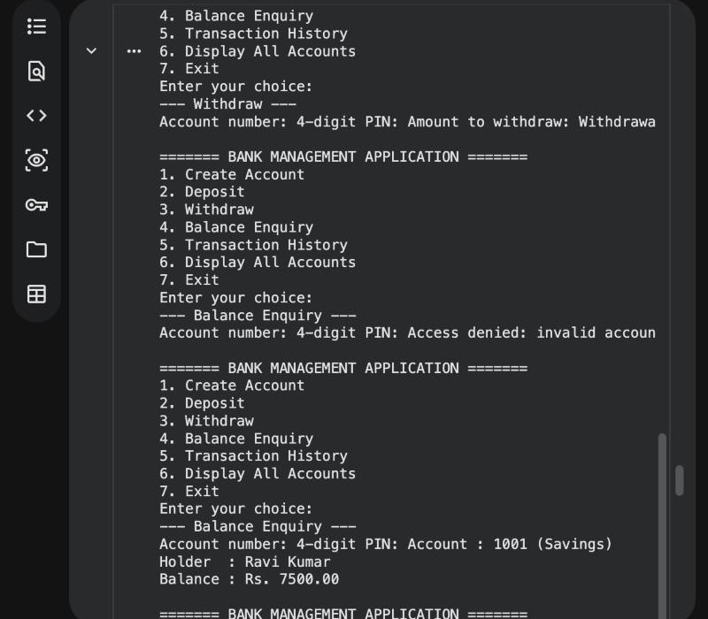
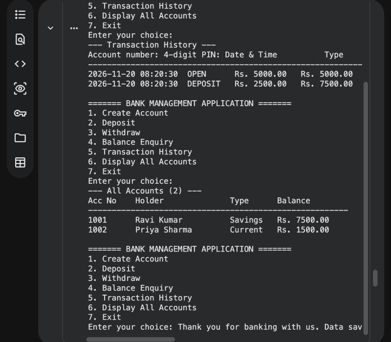
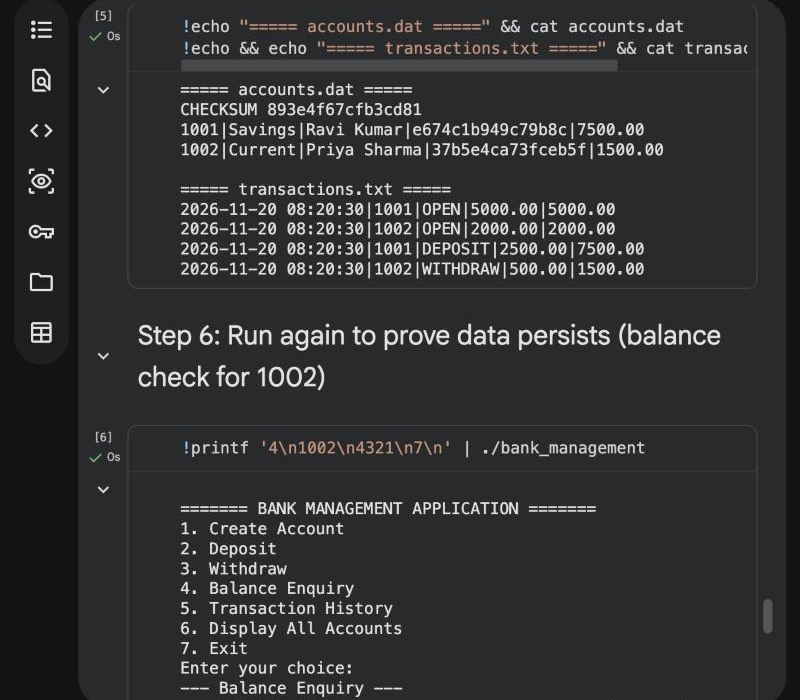
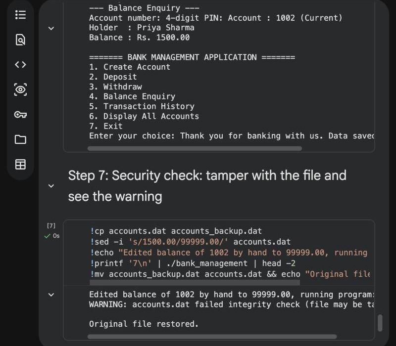

# Bank Management Application (C++)

A C++ console application that simulates core banking operations using **Object-Oriented Programming** and **file handling**.

[](https://colab.research.google.com/github/suma544/bank-management-application/blob/main/Bank_Management_Application.ipynb)

## Key Features
- **Create account:** Savings or Current, protected by a 4-digit PIN
- **Deposit** money
- **Withdraw** money. A Savings account must keep a minimum balance of Rs. 500.
- **Balance check:** only with the correct account number and PIN
- **Transaction history** with date and time
- **Display all accounts**
- **Menu-driven** with input checks

## OOP Concepts Used
| Concept | Where |
|---------|-------|
| Abstraction | Abstract base class `Account` with pure virtual `type()` and `minimumBalance()` |
| Inheritance | `SavingsAccount` and `CurrentAccount` derive from `Account` |
| Polymorphism | Withdraw limit is decided at runtime from the derived class |
| Encapsulation | Account data is `protected` and changed only through `deposit()` / `withdraw()` |

## Secure File Management
- `accounts.dat` stores account records. **PINs are never stored in plain text**, only as salted hashes.
- The file carries a **checksum**. If someone edits it by hand, the program shows a tamper warning.
- `transactions.txt` keeps a log of every transaction.

## Files
| File | Description |
|------|-------------|
| `bank_management.cpp` | Full C++ source code |
| `Bank_Management_Application.ipynb` | Google Colab notebook that writes, compiles and runs the program |
| `sample_input.txt` | Menu inputs used for the demo run |
| `output/colab_output.txt` | Full output from the Google Colab run |
| `output/accounts.dat`, `output/transactions.txt` | Data files produced by the program |
| `output/*.jpg` | Screenshots of the Colab run |

## Run it yourself
**Google Colab:** click the badge above, then *Runtime → Run all*.

**Locally:**
```bash
g++ -std=c++17 -o bank_management bank_management.cpp
./bank_management
```

## Output Screenshots (Google Colab)




